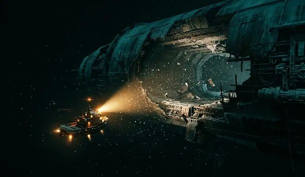

# The Lost Signal

## Opening transmission

It is the year 2727. Deep in uncharted space, a distress signal has been detected coming from the USS Horizon, a research vessel that disappeared nearly twenty years ago.

The ship is drifting near an unexplored planet, its engines offline and its communications mysteriously disabled. No life signs have been detected, but the ship's emergency beacon continues to transmit a repeating message.

You and your teammate are part of an investigation crew sent to board the vessel and uncover what happened to its missing crew.

As your shuttle approaches the airlock, the ship suddenly powers on its exterior lights.

Something aboard the Horizon is still active.

- 🛸 [Begin your investigation](scenes/scene1.md)

