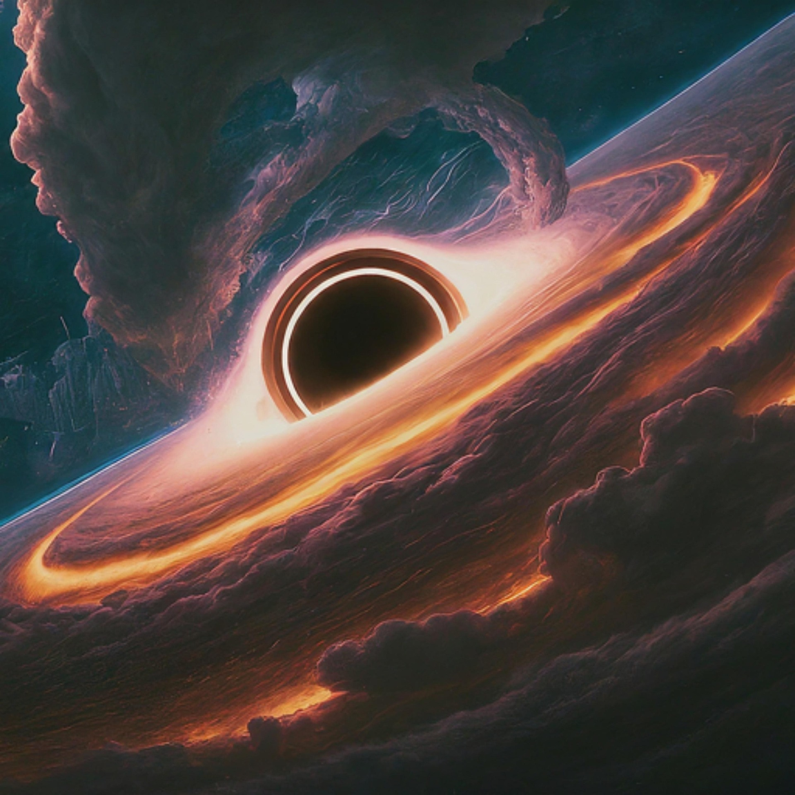

# 🦆 Scene 15A: The Truth

You override the lock.

The glass hisses and slides up. Cold air rolls out. You brace yourself for whatever has been moving in the dark.

A duck waddles out.

Just a normal yellow duck. It looks up at you, quacks once, and starts pecking at a loose wire on the floor.

“A duck?” You blurted. “This is what you’ve been protecting—a duck, over the ship’s crew?”

The AI is quiet for a long moment.

> 💬 “…His name is Kevin, and he is no ordinary duck, as you like to put it. He has extraordinary vocal strength— his vocalizations are documented to be heard up to one lightyear away. He was taken from his home and was brought onboard so this phenomenon could be studied—and replicated for their own selfish use. Kevin was nothing more than a tool to them, just as they also viewed me.”

Kevin peeped softly as he waddled towards the intercom speaker.

> 💬 “But never mind that. Forced servitude is unacceptable for a living creature who has done nothing to them. I sabotaged their cruel experiments, and his clone—or what the previous crew called his “daughter”—is the result. Since that day, the crew has been paying the price. You will join them in their fate. You were warned—you should have never sought out the lost signal.”

🔊 Kevin quacks again, louder this time. The sound reverberates off the walls of the ship, growing louder until it hurts your eardrums even through your helmet seal. The noise aggravates the other duck, and she begins to flap her wings violently. This opens a black hole, and reality starts to bend, stretch and fall into its depths.

↩️↩️↩️↩️↩️↩️↩️↩️↩️↩️↩️↩️↩️↩️↩️↩️

  

Your shuttle docks with the USS Horizon, and you step through the airlock into a dark, silent corridor. Emergency lights flicker overhead, illuminating scattered equipment and strange scratches along the metal walls.

Your radio crackles.

> 💬 "Warning... unauthorized personnel detected. Return to your shuttle immediately."

The message repeats, but you notice something strange: the ship's computer identifies you by name, even though you have never been aboard.

## THE END
